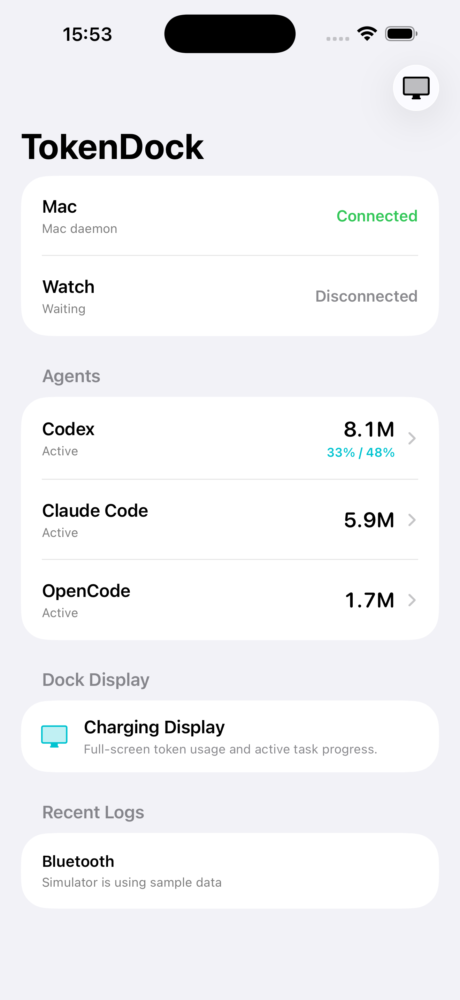
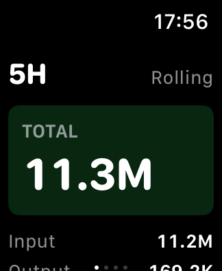

# TokenDock

A local-first, BLE-powered companion ecosystem for [xbar AI Token Usage](https://github.com/foxleoly/xbar-ai-usage). It shares the same agent-usage data that the xbar plugin reads, but surfaces it on macOS, iPhone, and Apple Watch without any cloud or WebSocket transport.

**Architecture:** a macOS daemon reads local Codex / Claude Code / OpenCode / Qwen Code / Pi usage data, advertises usage snapshots over Bluetooth LE, an iPhone app receives and caches them, and an Apple Watch app shows compact usage screens.




## Components

```text
mac-daemon/   macOS BLE peripheral + local agent usage collectors
iphone-app/   iPhone app with an embedded Watch target, shared models, tests
watch-app/    standalone Watch simulator project used for UI iteration
```

### mac-daemon

- macOS launch-agent daemon that reads local agent usage from SQLite / JSONL sources.
- Builds an `agent_usage_snapshot` JSON payload and advertises it over BLE as a peripheral.
- Usage windows: rolling 5 hours, today, 7 days, 30 days.

### iphone-app

- SwiftUI app host (Xcode project) with display name **TokenDock**, bundle ID `com.foxleoly.TokenDock`.
- BLE central receiver: scans for the Mac daemon, subscribes to snapshot notifications, reassembles 9-byte BLE chunks, decodes `AgentUsageSnapshot`, saves the latest snapshot, and appends JSONL logs.
- Embedded companion Watch target (`TokenDock Watch`).
- Charging / "Dock Display" mode that shows usage at a glance while phone is charging.

### watch-app

- Standalone watchOS sample app (target watchOS 8.0+) for fast UI iteration in the simulator.
- Four swipeable pages: 5H, Today, 7D, 30D.

## BLE wire format

- BLE service UUID: `8B7D2F4E-9678-4A13-A890-A5E89D7D6C01`
- BLE snapshot characteristic UUID: `0A5B95C6-20B7-4149-8E26-AB0BD034A07C`
- 9-byte message header: magic `0x41 0x55`, version `0x01`, then big-endian `UInt16` message ID, chunk index, and chunk count.

## Build & test

```bash
cd iphone-app && swift run agent-usage-bridge-tests
cd mac-daemon && swift run agent-usage-tests
```

## License

MIT License
